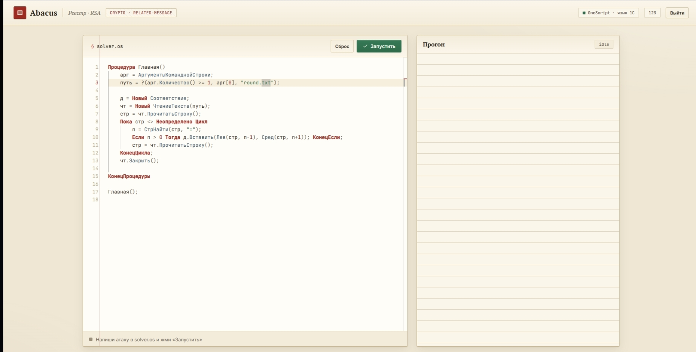
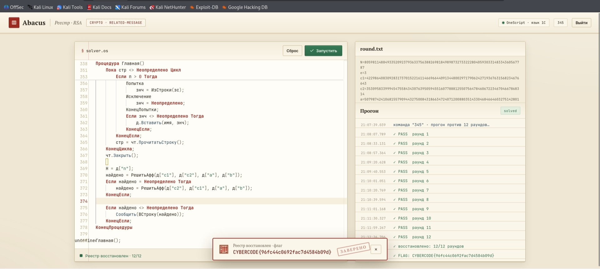

# Abacus — Реестр RSA

**CyberCode CTF | Crypto / Related Message**

## Условие задачи

> В конторе ведут реестр — и каждая запись в нём запечатана «настоящим» ключом: две тысячи бит, не
> подобрать и за век. Счетовод спокоен: сломать замок нельзя. Но замок — не единственная дверь. Две
> соседние записи реестра отличаются на известную мелочь (сосед по номеру, та же форма), и обе
> заперты слишком коротким ключом. Там, где замок одинаков, а содержимое — почти одно и то же,
> между двумя шифртекстами протягивается ниточка. Потяни за правильную — и запись распахнётся
> сама, без всякого перебора. Вокруг навалено лишнего: один и тот же модуль под разными ключами,
> веер одинаковых рассылок. Всё это выглядит как вход — и всё это тупики. Настоящий путь один, и он
> тоньше. И считать придётся руками: у счётовода нет «длинных чисел». Сложение, умножение,
> деление, остаток, обратное по модулю — всё в столбик, своими силами, на его же языке.



В задании был реестр, записи которого зашифрованы с помощью RSA. По условию использовался
большой ключ, поэтому обычный перебор или попытка разложить модуль на множители нам не
подходили.

При этом в описании был намёк, что две соседние записи связаны между собой. Они имеют почти
одинаковое содержимое и зашифрованы с использованием одного модуля RSA.

Нужно было воспользоваться этой связью и восстановить исходное сообщение, не взламывая сам RSA.

Также было дополнительное ограничение: весь алгоритм нужно было написать на языке 1С (OneScript),
причём без готовых средств для работы с большими числами. Все основные математические операции
необходимо было реализовать самостоятельно.

Программа должна была читать данные из файла round.txt, находить исходное сообщение и выводить
ответ. Всего нужно было пройти 12 раундов.

## Первые предположения и попытки решения

Изначально задача была сложнее из-за того, что организаторы не предоставили содержимое round.txt.

Было только текстовое описание и редактор, в котором нужно было писать программу.

Поэтому сначала пришлось разбираться, какую именно уязвимость RSA имели в виду авторы.

В условии говорилось, что две записи отличаются на известную величину. Из этого мы предположили,
что здесь используется атака Franklin–Reiter, которая позволяет восстановить сообщение, если известна
связь между двумя исходными сообщениями.

Первым предположением было, что сообщения отличаются на какое-то число d:

$$m_2 = m_1 + d$$
То есть второе сообщение получается прибавлением известного числа к первому.

Также мы предположили, что используется маленькая открытая экспонента RSA, скорее всего e = 3. Для
такого случая существует формула, которая позволяет найти исходное сообщение через два
шифртекста и разницу между ними.

Сначала мы пробовали самые простые значения d = 1 и d = 2, потому что в условии упоминались
соседние записи реестра. Потом рассматривали и другие варианты.

Поскольку настоящие данные не были видны, приходилось предусматривать разные способы их записи.

Мы пробовали определять модуль и шифртексты по размерам чисел, проверять различные значения
разницы и перебирать возможные комбинации.

Для небольших значений d был сделан перебор вплоть до нескольких миллионов вариантов.

Кроме этого, рассматривали две другие атаки на RSA:

- **Common Modulus Attack** — когда один модуль используется с разными открытыми показателями.

- **Broadcast Attack** — когда одно сообщение отправляют нескольким получателям с маленькой
экспонентой.

Параллельно пришлось разбираться с чтением входных данных. Самая первая версия программы
просто открывала round.txt, читала его построчно и разбивала строки по знаку =. Позже добавились
обработка чисел в десятичном и шестнадцатеричном виде и проверка разных вариантов входных
данных.

Также пробовали менять формат вывода: выводить само число, преобразовывать его в текст через UTF-8 и CP1251. Было предположение, что проверяющая система ожидает какой-то конкретный формат
ответа.

> [!WARNING]
> Но эти попытки не помогли. Проверки показывали **12/12 FAIL**.

В итоге стало понятно, что проблема, скорее всего, не в формате ответа, а в том, что мы неправильно
определили связь между сообщениями.

## Организаторы раскрыли round.txt

Спустя некоторое время организаторы раскрыли пример входных данных.

Теперь стало известно, что в файле находятся следующие параметры:

- `N` — модуль RSA;
- `e = 3` — открытая экспонента;
- `c1` и `c2` — два зашифрованных сообщения;
- `a` и `b` — дополнительные числа, которые используются для связи сообщений.

После этого задача стала понятнее, потому что появилась возможность проверять предположения на
реальных числах, а не только ориентироваться на описание.

Мы снова проверили предыдущий вариант с обычной разницей между сообщениями.

В качестве d пробовали значения 1, 2, a, b, a-b и b-a. Также проверяли небольшие значения перебором.

Ни один из этих вариантов не подошёл.

Тогда мы предположили, что числа a и b используются не как обычная разница, а как коэффициенты в
формуле:

$$m_2 = a \cdot m_1 + b \pmod{N}$$
То есть второе сообщение получается из первого не только прибавлением числа, но ещё и умножением
на коэффициент.

Такая связь называется аффинной. По сути, это более общий вариант той атаки, которую мы пытались
использовать с самого начала.

Для проверки мы использовали Python, потому что в нём удобно работать с большими числами и можно
быстро проверить математическую часть, прежде чем переносить её на 1С.

Составили два выражения на основе RSA:

$$m^3 \equiv c_1 \pmod{N}$$

$$(am+b)^3 \equiv c_2 \pmod{N}$$
Здесь m — исходное сообщение, которое нужно найти.

Далее применили обобщённую атаку Franklin–Reiter. Смысл в том, что оба выражения содержат одно
неизвестное сообщение. Если использовать известную связь между ними, можно получить это
сообщение без перебора ключа.

В Python проверили решение через нахождение общего корня двух многочленов.

В результате получилось число:

```
25466462694692016015246535263672049495347769129847819932200668038341568481097
```
После этого проверили его обратной подстановкой в обе формулы RSA.

Обе проверки сошлись. Это означало, что найденное число действительно подходит к двум
шифртекстам, а предположение про связь через a и b правильное.

Получилось, что основная ошибка первых попыток была в неправильном понимании подсказки.

Сообщения не просто отличались на небольшое число — между ними была линейная связь.

## Написание итогового алгоритма на 1С

Когда математическая часть стала понятна, осталось реализовать её на OneScript.

Главная сложность была в работе с большими числами.

Обычных числовых возможностей языка было недостаточно для удобного выполнения всех операций с
такими значениями, а готовые библиотеки больших чисел использовать было нельзя.

Поэтому мы сделали собственную реализацию длинной арифметики.

Каждое большое число хранилось в виде массива, где один элемент содержал часть числа длиной до 9
десятичных цифр.

Например, число 123456789012345678 можно представить как две части:
`[12345678, 123456789]`
При этом младшая часть хранится первой.

Так можно работать с числами большой длины, выполняя действия отдельно над элементами массива.

Для этого в программе были написаны функции:
- сложения и вычитания с переносами;
- умножения по принципу обычного умножения в столбик;
- деления с получением остатка;
- сравнения больших чисел;
- возведения числа в куб по модулю;
- нахождения обратного числа по модулю.
Последняя операция была нужна для основной формулы атаки. Для её реализации использовался
бинарный расширенный алгоритм Евклида.

Когда основные математические функции были готовы, можно было написать само решение.

Для случая e = 3 удалось получить формулу, которая сразу восстанавливает сообщение.

Сначала вычисляются три промежуточных значения:

$$A_2 = 3a^2b$$

$$A_1 = 3ab^2$$

$$A_0 = b^3-c_2+a^3c_1$$

Затем по ним находится исходное сообщение:

$$m=(c_1A_2^2-A_1A_0)(A_1^2-A_0A_2)^{-1}\pmod{N}$$
Знак ⁻¹ здесь обозначает обратное число по модулю, которое программа тоже вычисляет
самостоятельно.

Все операции выполняются по модулю N.

Эта формула позволяет получить сообщение напрямую, без перебора возможных значений.

Чтобы убедиться, что программа нашла правильное число, после вычисления выполняются две
проверки:

$$m^3 \bmod N = c_1$$

$$(am+b)^3 \bmod N = c_2$$
Если оба равенства выполняются, значит сообщение восстановлено правильно.

После этого программа выводит найденное число в десятичном виде.

## Некоторые трудности, с которыми мы столкнулись

После того как удалось найти правильную формулу, задача ещё не была полностью решена.

В промежуточной версии программы осталась дополнительная логика на случай, если входные данные
будут записаны с другими названиями параметров.

Программа пыталась самостоятельно определить, какие числа являются модулем, шифртекстами и
коэффициентами. Для этого она перебирала разные комбинации чисел.

Это было полезно на этапе, когда содержимое round.txt оставалось неизвестным, но после публикации
данных такой перебор уже был не нужен.

Из-за него программа работала слишком долго.

В одном из прогонов часть раундов уже проходила успешно — получилось 7 из 12, но остальные не
успевали выполниться из-за ограничения по времени, которое составляло около 300 секунд.

После этого мы убрали лишний перебор и оставили только основной алгоритм.

Итоговая программа работала следующим образом:

1. Сначала она открывала round.txt и считывала значения N, c1, c2, a и b.
2. Затем преобразовывала их в свой формат больших чисел и применяла формулу Franklin–Reiter для
аффинной связи.
3. Если проверка результата проходила успешно, программа выводила найденное сообщение.

На всякий случай также оставили проверку с перестановкой c1 и c2.

В итоге получилась более короткая и быстрая версия программы, которая уже не тратила время на
ненужный перебор.

## Получение флага

После всех исправлений мы запустили итоговый solver.os в проверяющей системе.

На этот раз программа успешно прошла все 12 раундов.

В окне проверки появились результаты PASS для каждого раунда, а затем сообщение:

> [!TIP]
> **Реестр восстановлен: 12/12**
После этого система выдала флаг:

`CYBERCODE{96fc44c0692fac7d4584b09d}`


