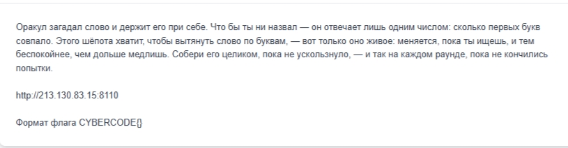
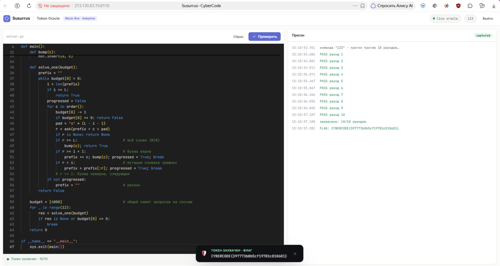

# Susurrus — Token Oracle

**CyberCode CTF | Black-Box / Adaptive**

## Условие задачи

> Оракул загадал слово и держит его при себе. Что бы ты ни назвал — он отвечает лишь одним числом: сколько первых букв совпало. Этого шёпота хватит, чтобы вытянуть слово по буквам, — вот только оно живое: меняется, пока ты ищешь, и тем беспокойнее, чем дольше медлишь. Собери его целиком, пока не ускользнуло, — и так на каждом раунде, пока не кончились попытки.

В задании нужно было угадать секретное слово и пройти 10 раундов. При этом оракул сообщал не само слово, а количество совпадающих символов с его начала.

## Первые предположения

Сначала мы решили, что раз сервис сообщает количество совпавших символов, то нет необходимости перебирать все возможные слова целиком.

Например, если первые две буквы уже известны, можно проверять варианты третьей буквы и смотреть, увеличилось ли количество совпадений.

Для взаимодействия с сервисом использовали Python и библиотеку `socket`. В первоначальном варианте предусмотрели чтение приветствия сервера и получение длины слова из параметра `len`. Если длина отсутствовала, проверялись варианты от 1 до 24.

В коде были предусмотрены следующие ответы:

- `S n` — количество совпавших начальных символов;
- `WIN` — полное совпадение;
- отсутствие ответа — завершение соединения.

## Промежуточное решение

Первый алгоритм последовательно восстанавливал слово по одному символу. Для проверки очередной буквы оставшаяся часть строки заполнялась символом `a`.

Для перебора использовали латинские буквы обоих регистров, цифры и специальные символы — всего 67 символов.

Затем добавили обработку нескольких раундов в рамках одной TCP-сессии.

> Промежуточный вариант проходил примерно половину раундов.

## Почему первоначальный алгоритм не подходил

Основная проблема была в том, что мы исходили из предположения, что слово остаётся неизменным хотя бы в пределах одного раунда.

Но в условии прямо говорилось, что слово может меняться во время поиска. Получалось, что уже найденная часть слова могла перестать совпадать с текущим секретом.

Первоначальная программа не учитывала это и продолжала работать с устаревшим префиксом.

## Доработка решения

В итоговой версии мы изменили подход: вместо того чтобы считать найденную часть слова неизменной, стали учитывать возможность её изменения.

Также отказались от перебора всех возможных длин. При отсутствии параметра `len` использовали длину 8, указанную в итоговом коде.

Чтобы сократить количество лишних проверок, добавили список ранее найденных символов. 

Задача также показала, почему при проверке секретных значений нельзя сообщать пользователю, какая часть введённого значения оказалась правильной.

